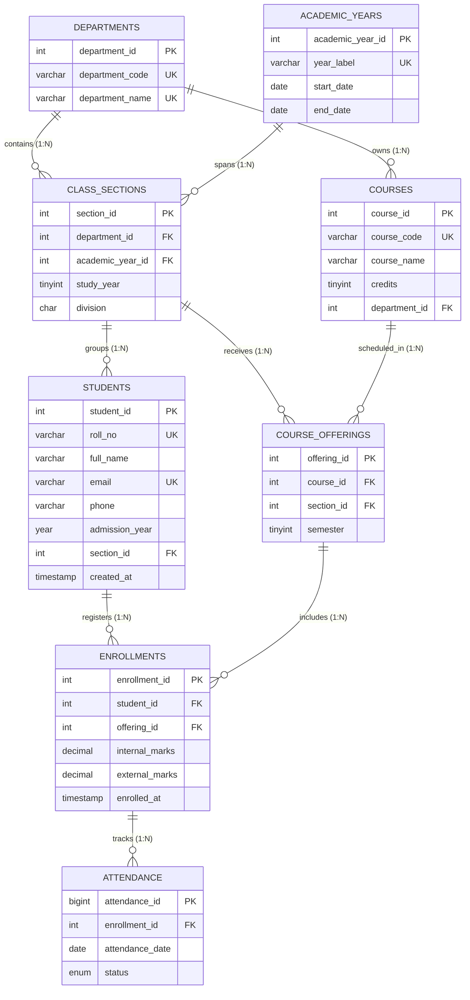

# CampusCore SIS — Comprehensive Database Architecture & Relational Understanding Guide

> **Project Identity:** CampusCore SIS (Student Information & Academic Management System)  
> **Course / Context:** Database Management Systems (DBMS) Mini Project  
> **RDBMS Engine:** MySQL 8.0+ (InnoDB Storage Engine)  
> **Backend Architecture:** Node.js, Express, `mysql2/promise`  
> **Schema Normalization:** Third Normal Form (3NF) & BCNF-compliant Relations  

---

## 1. Executive Overview & System Architecture

**CampusCore SIS** is an institutional academic records system developed to model college administration workflows. It replaces error-prone flat records with a normalized relational database that guarantees referential integrity, eliminates data anomalies, and provides high-performance data retrieval.

### Core Architecture Characteristics
- **Storage Engine:** `InnoDB` provides ACID-compliant transactions, row-level locking, and foreign-key constraint enforcement.
- **Character Set & Collation:** `utf8mb4` with `utf8mb4_0900_ai_ci` supporting international characters, names, and case-insensitive matching.
- **Connection Pooling:** Configured with `mysql2/promise` with up to 10 pooled connections to optimize database socket reuse and prevent connection starvation.
- **Security:** Parameterized SQL queries (prepared statements) protect every interaction from SQL Injection (SQLi).

```
+-----------------------------------------------------------------------------------+
|                                 CampusCore SIS UI                                 |
|          (Executive Dashboard · Directory · Structure · Enrollments · Queries)    |
+-----------------------------------------------------------------------------------+
                                          |
                                    HTTP / JSON
                                          v
+-----------------------------------------------------------------------------------+
|                             Node.js + Express Backend                             |
|          (Prepared Statements · Input Validation · Transaction Boundaries)        |
+-----------------------------------------------------------------------------------+
                                          |
                              Connection Pool (mysql2)
                                          v
+-----------------------------------------------------------------------------------+
|                               MySQL 8.0 (InnoDB)                                  |
|  departments · academic_years · class_sections · students · courses ·             |
|  course_offerings · enrollments · attendance                                      |
+-----------------------------------------------------------------------------------+
```

---

## 2. Entity-Relationship (ER) Architecture

The schema contains 8 relational tables designed to balance conceptual clarity with strict normalization.

### 2.1 Mermaid ER Diagram



### 2.2 Entity Categorization & Relationship Breakdown

1. **Independent / Kernel Entities:**
   - `departments`: Academic branches (Computer, Mechanical, Civil).
   - `academic_years`: Institutional calendar sessions (e.g., `2026-2027`).
   - `courses`: Master curriculum definitions independent of specific batches.

2. **Dependent / Characteristic Entities:**
   - `class_sections`: Subdivided groups within a department, academic year, and study level.
   - `students`: Enrolled individuals assigned to a current section.

3. **Associative / Intersection Entities (Resolving M:N Relationships):**
   - **`course_offerings`**: Resolves the Many-to-Many relationship between `courses` and `class_sections`. A course can be offered to multiple sections; a section takes multiple courses.
   - **`enrollments`**: Resolves the Many-to-Many relationship between `students` and `course_offerings`. Stores student-specific examination marks.

4. **Transactional Fact Entity:**
   - `attendance`: Records day-to-day session participation linked specifically to a student's course enrollment.

---

## 3. Data Dictionary & Detailed Table Specifications

### 3.1 `departments`
Stores academic department classifications.
| Column | Type | Constraints | Description |
|---|---|---|---|
| `department_id` | `INT` | `PK, AUTO_INCREMENT` | Surrogate primary key. |
| `department_code` | `VARCHAR(15)` | `NOT NULL, UNIQUE` | Short branch identifier (e.g., `COMP`, `MECH`). |
| `department_name` | `VARCHAR(100)` | `NOT NULL, UNIQUE` | Full official department title. |

### 3.2 `academic_years`
Tracks university academic sessions with temporal boundary validation.
| Column | Type | Constraints | Description |
|---|---|---|---|
| `academic_year_id` | `INT` | `PK, AUTO_INCREMENT` | Surrogate primary key. |
| `year_label` | `VARCHAR(9)` | `NOT NULL, UNIQUE` | Session descriptor (e.g., `2026-2027`). |
| `start_date` | `DATE` | `NOT NULL` | Session start date. |
| `end_date` | `DATE` | `NOT NULL, CHECK (end_date > start_date)` | Session conclusion date. |

### 3.3 `class_sections`
Uniquely identifies student groupings by department, year, and division.
| Column | Type | Constraints | Description |
|---|---|---|---|
| `section_id` | `INT` | `PK, AUTO_INCREMENT` | Surrogate primary key. |
| `department_id` | `INT` | `NOT NULL, FK -> departments` | Owning academic department. |
| `academic_year_id` | `INT` | `NOT NULL, FK -> academic_years` | Relevant academic session. |
| `study_year` | `TINYINT UNSIGNED` | `NOT NULL, CHECK (1 TO 4)` | Engineering year: 1 (FE), 2 (SE), 3 (TE), 4 (BE). |
| `division` | `CHAR(1)` | `NOT NULL, CHECK (REGEXP '^[A-Z]$')` | Class division group (`A`, `B`, `C`). |
| *Composite Key* | `UNIQUE` | `(department_id, academic_year_id, study_year, division)` | Ensures no duplicate sections are created. |

### 3.4 `students`
Maintains individual student profiles.
| Column | Type | Constraints | Description |
|---|---|---|---|
| `student_id` | `INT` | `PK, AUTO_INCREMENT` | Surrogate primary key. |
| `roll_no` | `VARCHAR(20)` | `NOT NULL, UNIQUE` | Institutional roll number (e.g., `301`). |
| `full_name` | `VARCHAR(100)` | `NOT NULL, INDEX` | Full legal name of student. |
| `email` | `VARCHAR(120)` | `NULLABLE, UNIQUE` | Official communication email. |
| `phone` | `VARCHAR(20)` | `NULLABLE` | Contact telephone number. |
| `admission_year`| `YEAR` | `NULLABLE` | Calendar year of matriculation. |
| `section_id` | `INT` | `NOT NULL, FK -> class_sections, INDEX` | Current active class section. |
| `created_at` | `TIMESTAMP` | `DEFAULT CURRENT_TIMESTAMP` | Record timestamp. |

### 3.5 `courses`
Curriculum syllabus catalogue.
| Column | Type | Constraints | Description |
|---|---|---|---|
| `course_id` | `INT` | `PK, AUTO_INCREMENT` | Surrogate primary key. |
| `course_code` | `VARCHAR(20)` | `NOT NULL, UNIQUE` | Curriculum code (e.g., `DBMS`, `ML`). |
| `course_name` | `VARCHAR(120)` | `NOT NULL` | Descriptive title of course. |
| `credits` | `TINYINT UNSIGNED` | `NOT NULL, CHECK (1 TO 10)` | Credit weight assigned to course. |
| `department_id` | `INT` | `NOT NULL, FK -> departments` | Academic department offering course. |

### 3.6 `course_offerings`
Maps courses to specific class sections and semesters.
| Column | Type | Constraints | Description |
|---|---|---|---|
| `offering_id` | `INT` | `PK, AUTO_INCREMENT` | Surrogate primary key. |
| `course_id` | `INT` | `NOT NULL, FK -> courses` | Subject reference. |
| `section_id` | `INT` | `NOT NULL, FK -> class_sections` | Section attending subject. |
| `semester` | `TINYINT UNSIGNED` | `NOT NULL, CHECK (1 TO 8)` | Specific semester term. |
| *Composite Key* | `UNIQUE` | `(course_id, section_id, semester)` | Prevents identical course allocations to same section. |

### 3.7 `enrollments`
Tracks student course registration and examination marks.
| Column | Type | Constraints | Description |
|---|---|---|---|
| `enrollment_id` | `INT` | `PK, AUTO_INCREMENT` | Surrogate primary key. |
| `student_id` | `INT` | `NOT NULL, FK -> students` | Enrolled student. |
| `offering_id` | `INT` | `NOT NULL, FK -> course_offerings` | Course offering instance. |
| `internal_marks`| `DECIMAL(5,2)` | `CHECK (NULL OR BETWEEN 0 AND 100)` | Continuous assessment score. |
| `external_marks`| `DECIMAL(5,2)` | `CHECK (NULL OR BETWEEN 0 AND 100)` | End-semester assessment score. |
| `enrolled_at` | `TIMESTAMP` | `DEFAULT CURRENT_TIMESTAMP` | Enrollment timestamp. |
| *Composite Key* | `UNIQUE` | `(student_id, offering_id)` | Restricts duplicate enrollment of same course. |

### 3.8 `attendance`
Maintains daily session attendance per course enrollment.
| Column | Type | Constraints | Description |
|---|---|---|---|
| `attendance_id` | `BIGINT` | `PK, AUTO_INCREMENT` | Surrogate primary key. |
| `enrollment_id` | `INT` | `NOT NULL, FK -> enrollments` | Associated student enrollment. |
| `attendance_date`| `DATE` | `NOT NULL, INDEX` | Class meeting date. |
| `status` | `ENUM` | `'Present', 'Absent', 'Late'` | Attendance status. |
| *Composite Key* | `UNIQUE` | `(enrollment_id, attendance_date)` | Blocks duplicate records for same student/date. |

---

## 4. Referential Integrity, Foreign Keys & Cascade Actions

### 4.1 The Role of `ON UPDATE CASCADE ON DELETE RESTRICT`
All foreign keys in CampusCore SIS enforce:
```sql
ON UPDATE CASCADE ON DELETE RESTRICT
```
1. **`ON UPDATE CASCADE`**:
   If an underlying primary key or unique code changes, MySQL cascades the updated value to all dependent child rows automatically.
2. **`ON DELETE RESTRICT`**:
   Prevents accidental deletion of parent records. For example:
   - You **cannot** delete a department if class sections or courses reference it.
   - You **cannot** delete a student if enrollments exist.
   - You **cannot** delete a course offering if students are enrolled.
   This guarantees that historical academic scores and attendance registers are never orphaned.

### 4.2 Composite Uniqueness Constraints
In institutional software, natural keys are often composite:
- `uq_class_section (department_id, academic_year_id, study_year, division)`: Division "A" is not unique across the college; only Division "A" of Computer Engineering in Year 3 for Academic Year 2026-2027 is unique.
- `uq_course_offering (course_id, section_id, semester)`: Guarantees a course is not assigned twice to the same division in the same semester.
- `uq_student_offering (student_id, offering_id)`: Prevents enrolling the same student twice into the same course offering.
- `uq_attendance_day (enrollment_id, attendance_date)`: Guarantees attendance can only be taken once per student per day for a subject.

---

## 5. Comprehensive Database Normalization Analysis

### 5.1 Unnormalized Form (UNF)
In an unnormalized flat spreadsheet or table:
```
Student_Record_UNF (
  roll_no, full_name, email, phone, admission_year,
  dept_code, dept_name, academic_year, study_year, division,
  course_code, course_name, credits, semester,
  internal_marks, external_marks, attendance_date, attendance_status
)
```
**Anomalies Present in UNF:**
- **Redundancy:** Department name and course title are repeated on every row for every student and every date.
- **Insertion Anomaly:** Cannot record a new course until a student enrolls in it; cannot register a department until a section exists.
- **Update Anomaly:** Updating a course credit requires updating hundreds of rows; if one row fails, data becomes inconsistent.
- **Deletion Anomaly:** Deleting a student who is the sole member of a division deletes the existence of that division or course offering.

---

### 5.2 First Normal Form (1NF)
> **Definition:** A relation is in 1NF if every attribute contains only atomic (indivisible) values, and there are no repeating groups or multi-valued attributes.

**Application in CampusCore SIS:**
- Full name, roll number, and contact values are stored in individual scalar columns.
- Multiple courses taken by a student are **not** stored as comma-separated lists (`"DBMS, OS, ML"`), but as distinct rows in `enrollments`.
- Attendance is recorded on a per-date basis as individual rows in `attendance`.

---

### 5.3 Second Normal Form (2NF)
> **Definition:** A relation is in 2NF if it is in 1NF and every non-prime attribute is fully functionally dependent on the entire primary key (no partial functional dependency on composite candidate keys).

**Resolution:**
- In an enrollment relation with composite candidate key `(student_id, offering_id)`:
  - `student_name` depends only on `student_id` (partial dependency).
  - `course_name` depends only on `course_id` (partial dependency).
- We decompose this by isolating:
  - `students` (identifiable by `student_id`)
  - `courses` (identifiable by `course_id`)
  - `enrollments` (storing only `internal_marks` and `external_marks`, which depend strictly on the **combination** of student and course offering).

---

### 5.4 Third Normal Form (3NF)
> **Definition:** A relation is in 3NF if it is in 2NF and no non-prime attribute is transitively dependent on a candidate key ($X \to Y \to Z$ is eliminated).

**Resolution:**
- In `students`, we do **not** store `department_name` because `student_id -> section_id -> department_id -> department_name`.
  Storing `department_name` in `students` would create a transitive dependency.
- Instead, `students` holds only `section_id`. `class_sections` holds `department_id`. `departments` holds `department_name`.
- Changing a department's name requires **exactly one** update in `departments`.

---

### 5.5 Boyce-Codd Normal Form (BCNF)
> **Definition:** A relation is in BCNF if for every non-trivial functional dependency $X \to Y$, $X$ is a superkey.

In every relation in this schema:
- In `departments`: `department_id` and `department_code` are superkeys.
- In `class_sections`: The composite unique key `(department_id, academic_year_id, study_year, division)` is a candidate key.
- In `students`: `student_id` and `roll_no` are candidate keys.
- Every determinant is a candidate key; therefore, the relations satisfy BCNF.

---

## 6. The 12 DBMS Mini-Project SQL Queries Explained

The system implements 12 distinct relational SQL queries showcasing the full breadth of syllabus requirements:

### Query 1: Multi-Table INNER JOIN (Complete Student Directory)
```sql
SELECT s.roll_no, s.full_name, d.department_name, cs.study_year,
       cs.division, ay.year_label
FROM students s
JOIN class_sections cs ON cs.section_id = s.section_id
JOIN departments d ON d.department_id = cs.department_id
JOIN academic_years ay ON ay.academic_year_id = cs.academic_year_id
ORDER BY d.department_name, cs.division, s.roll_no;
```
- **DBMS Concept:** 4-table relational `INNER JOIN` navigating Foreign Key paths.
- **Relational Algebra:** $\pi_{roll\_no, full\_name, \dots} (students \bowtie class\_sections \bowtie departments \bowtie academic\_years)$

---

### Query 2: LEFT OUTER JOIN with Aggregation (Student Count by Division)
```sql
SELECT d.department_name, cs.study_year, cs.division, ay.year_label,
       COUNT(s.student_id) AS total_students
FROM class_sections cs
JOIN departments d ON d.department_id = cs.department_id
JOIN academic_years ay ON ay.academic_year_id = cs.academic_year_id
LEFT JOIN students s ON s.section_id = cs.section_id
GROUP BY cs.section_id, d.department_name, cs.study_year, cs.division, ay.year_label
ORDER BY d.department_name, cs.division;
```
- **DBMS Concept:** `LEFT OUTER JOIN` preserves sections even if they have 0 registered students (an `INNER JOIN` would erroneously drop empty sections).

---

### Query 3: Multi-Table Filtered Join (COMP Div A, Sem 5 Course Offerings)
```sql
SELECT c.course_code, c.course_name, co.semester
FROM course_offerings co
JOIN courses c ON c.course_id = co.course_id
JOIN class_sections cs ON cs.section_id = co.section_id
JOIN departments d ON d.department_id = cs.department_id
WHERE d.department_code = 'COMP' AND cs.division = 'A'
  AND cs.study_year = 3 AND co.semester = 5;
```
- **DBMS Concept:** Compound boolean filtering (`AND`) across normalized intersection entities.

---

### Query 4: Aggregate Function with Arithmetic Expression (Average Marks per Course)
```sql
SELECT c.course_code, c.course_name,
       ROUND(AVG(e.internal_marks + e.external_marks), 2) AS average_total
FROM enrollments e
JOIN course_offerings co ON co.offering_id = e.offering_id
JOIN courses c ON c.course_id = co.course_id
GROUP BY c.course_id, c.course_code, c.course_name;
```
- **DBMS Concept:** `AVG()` aggregation combined with arithmetic scalar expression `(internal + external)`.

---

### Query 5: GROUP BY with HAVING Clause (High Achievers)
```sql
SELECT s.roll_no, s.full_name,
       ROUND(AVG(e.internal_marks + e.external_marks), 2) AS average_marks
FROM students s
JOIN enrollments e ON e.student_id = s.student_id
GROUP BY s.student_id, s.roll_no, s.full_name
HAVING AVG(e.internal_marks + e.external_marks) > 70;
```
- **DBMS Concept:** `HAVING` filters aggregated group results after grouping, whereas `WHERE` filters raw tuples before grouping.

---

### Query 6: Nested Subquery with `IN` Predicate (Students in DBMS)
```sql
SELECT roll_no, full_name
FROM students
WHERE student_id IN (
  SELECT e.student_id
  FROM enrollments e
  JOIN course_offerings co ON co.offering_id = e.offering_id
  JOIN courses c ON c.course_id = co.course_id
  WHERE c.course_code = 'DBMS'
);
```
- **DBMS Concept:** Uncorrelated nested subquery returning a set of keys evaluated by the outer query.

---

### Query 7: Conditional Ratio Aggregation (Attendance Compliance Percentage)
```sql
SELECT s.roll_no, s.full_name, c.course_code,
       COUNT(*) AS classes_recorded,
       ROUND(100 * SUM(a.status IN ('Present', 'Late')) / COUNT(*), 2) AS attendance_percentage
FROM attendance a
JOIN enrollments e ON e.enrollment_id = a.enrollment_id
JOIN students s ON s.student_id = e.student_id
JOIN course_offerings co ON co.offering_id = e.offering_id
JOIN courses c ON c.course_id = co.course_id
GROUP BY e.enrollment_id, s.roll_no, s.full_name, c.course_code;
```
- **DBMS Concept:** Boolean condition evaluated inside `SUM()` to calculate percentage ratios across 5 joined relations.

---

### Query 8: LEFT JOIN for Null Checking (Students with Enrollment Counts)
```sql
SELECT s.roll_no, s.full_name, COUNT(e.enrollment_id) AS enrolled_courses
FROM students s
LEFT JOIN enrollments e ON e.student_id = s.student_id
GROUP BY s.student_id, s.roll_no, s.full_name;
```
- **DBMS Concept:** `COUNT(column)` ignores `NULL`s returned by `LEFT JOIN`, accurately returning 0 for unenrolled students.

---

### Query 9: Group Maximum Value (Course Toppers)
```sql
SELECT c.course_code, MAX(e.internal_marks + e.external_marks) AS highest_total
FROM courses c
JOIN course_offerings co ON co.course_id = c.course_id
JOIN enrollments e ON e.offering_id = co.offering_id
GROUP BY c.course_id, c.course_code;
```
- **DBMS Concept:** `MAX()` aggregate function applied to combined expressions grouped by course.

---

### Query 10: Atomic Single-Row DML UPDATE
```sql
UPDATE students SET phone = '9999900000' WHERE roll_no = '301';
```
- **DBMS Concept:** Single-row targeted mutation using a `UNIQUE` candidate key predicate.

---

### Query 11: Transaction Boundary & ACID Atomicity Demonstration
```sql
START TRANSACTION;
-- Simulate isolated operations
SELECT 'Transaction opened safely' AS status;
ROLLBACK;
```
- **DBMS Concept:** Transaction boundaries guarantee ACID properties. Uncommitted operations leave zero residual state upon `ROLLBACK`.

---

### Query 12: RDBMS View Definition & Abstraction
```sql
CREATE OR REPLACE VIEW student_directory AS
SELECT s.student_id, s.roll_no, s.full_name, s.email, s.phone,
       d.department_name, cs.study_year, cs.division, ay.year_label
FROM students s
JOIN class_sections cs ON cs.section_id = s.section_id
JOIN departments d ON d.department_id = cs.department_id
JOIN academic_years ay ON ay.academic_year_id = cs.academic_year_id;

SELECT * FROM student_directory;
```
- **DBMS Concept:** Logical data independence. A virtual table providing simplified querying without storing redundant physical bytes.

---

## 7. Indexing Strategy & Query Optimization

In relational databases, indexes avoid costly full table scans ($O(N)$) by building B+ Tree structures ($O(\log N)$).

### Indexes Implemented in CampusCore SIS:
1. **Clustered Indexes (Primary Keys):**
   - Automatically generated by InnoDB on all Primary Keys (`department_id`, `section_id`, `student_id`, `course_id`, etc.). The actual table data is ordered by these keys on disk.
2. **Secondary Non-Clustered Indexes:**
   - `idx_student_name (students.full_name)`: Accelerates name-based directory searching.
   - `idx_student_section (students.section_id)`: Accelerates foreign key joins between sections and students.
   - `idx_enrollment_offering (enrollments.offering_id)`: Optimizes grade lookups by subject offering.
   - `idx_attendance_date (attendance.attendance_date)`: Accelerates daily attendance filtering and term date ranges.
3. **Unique B-Tree Indexes:**
   - Automatically created by MySQL for all `UNIQUE` constraints (`roll_no`, `course_code`, and composite unique constraints).

---

## 8. Master DBMS Viva Voce Guide (30 High-Frequency Questions)

### Q1: What is the primary difference between a File System and a Relational DBMS?
**Answer:** A file system stores data in flat files with no built-in concurrency control, no declarative query language, and high risks of data redundancy and inconsistency. An RDBMS stores data in structured tables, enforces referential integrity through foreign keys, ensures ACID transactions, supports declarative SQL, and provides indexing for fast lookups.

### Q2: Why did you choose surrogate primary keys (`AUTO_INCREMENT`) instead of natural keys?
**Answer:** Natural keys (like `roll_no` or composite keys) are subject to real-world modifications, require larger storage space when referenced as foreign keys across multiple tables, and complicate indexing. Surrogate integer keys remain constant, require only 4 bytes (`INT`), optimize foreign key join performance, and simplify cascading actions. Natural uniqueness is still strictly preserved using `UNIQUE` constraints.

### Q3: What is the difference between `DELETE RESTRICT` and `DELETE CASCADE`?
**Answer:**
- `CASCADE` deletes all dependent child rows when a parent row is deleted.
- `RESTRICT` forbids the deletion of a parent record as long as any child record references it. In CampusCore SIS, we use `RESTRICT` to prevent accidental deletion of students with historical marks or departments with active sections.

### Q4: Explain the difference between `WHERE` and `HAVING`.
**Answer:** `WHERE` filters individual rows *before* aggregation occurs. `HAVING` filters group rows *after* the `GROUP BY` clause and aggregate functions (like `AVG`, `SUM`, `COUNT`) have been calculated.

### Q5: What is a Many-to-Many (M:N) relationship and how is it implemented?
**Answer:** In M:N, multiple instances of entity A relate to multiple instances of entity B. For example, a student takes many courses, and a course has many students. RDBMS cannot directly link them using a single foreign key without violating 1NF. It is resolved using an **associative (junction) table**—`enrollments`—which contains foreign keys to both parent tables plus intersection attributes (marks).

### Q6: What are ACID properties?
**Answer:**
- **Atomicity:** All operations in a transaction succeed or all fail (`ROLLBACK`).
- **Consistency:** The database moves from one valid state to another, preserving all schema constraints.
- **Isolation:** Concurrent transactions execute without interfering with one another.
- **Durability:** Once committed, changes survive system failures.

### Q7: What is the difference between `CHAR` and `VARCHAR`?
**Answer:** `CHAR(n)` is fixed-length and pads spaces up to $n$ characters (used for `division CHAR(1)` where length is always 1). `VARCHAR(n)` is variable-length and stores only the actual characters plus 1–2 prefix bytes (used for names and emails to save disk space).

### Q8: What is a composite unique constraint? Give an example from your schema.
**Answer:** A constraint that enforces uniqueness across a tuple of multiple columns. In our schema:
`UNIQUE (department_id, academic_year_id, study_year, division)` guarantees that Division A of Year 3 in Computer Engineering cannot be created twice in the same academic session.

### Q9: Why is attendance linked to enrollment rather than directly to student?
**Answer:** A student attends specific classes for specific courses. Linking attendance directly to `student_id` would lose the context of which course was attended. Linking to `enrollment_id` guarantees that attendance is recorded strictly against an active course registration.

### Q10: How does your Node.js application prevent SQL Injection?
**Answer:** The backend uses parameterized queries (`pool.query(sql, [params])`). User input is sent separately from the SQL statement as typed parameters, so database query parsers treat input strictly as literals rather than executable SQL syntax.

*(For additional viva preparation, refer to `docs/VIVA_QUESTIONS.md` in the documentation folder).*

---

## 9. Setup, Verification & Maintenance Script

### 9.1 Database Creation & Seeding
From the project folder, run in MySQL command line or Workbench:
```sql
SOURCE database/schema.sql;
SOURCE database/seed.sql;
```

### 9.2 Verification Checklist
Execute these checks in MySQL:
```sql
USE student_management;

-- 1. Verify all 8 tables exist
SHOW TABLES;

-- 2. Verify row counts
SELECT 'departments' AS tbl, COUNT(*) AS count FROM departments
UNION ALL SELECT 'academic_years', COUNT(*) FROM academic_years
UNION ALL SELECT 'class_sections', COUNT(*) FROM class_sections
UNION ALL SELECT 'students', COUNT(*) FROM students
UNION ALL SELECT 'courses', COUNT(*) FROM courses
UNION ALL SELECT 'course_offerings', COUNT(*) FROM course_offerings
UNION ALL SELECT 'enrollments', COUNT(*) FROM enrollments
UNION ALL SELECT 'attendance', COUNT(*) FROM attendance;

-- 3. Verify Foreign Key constraint action
SELECT CONSTRAINT_NAME, TABLE_NAME, REFERENCED_TABLE_NAME, DELETE_RULE, UPDATE_RULE
FROM information_schema.REFERENTIAL_CONSTRAINTS
WHERE CONSTRAINT_SCHEMA = 'student_management';
```

---
*CampusCore SIS — DBMS Mini Project Relational Understanding Specification*
