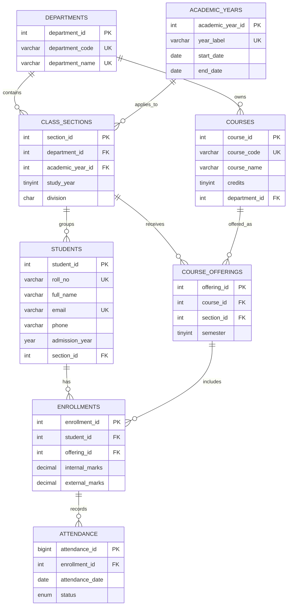

# Student Management System — ER model

## Why the `class_sections` table exists

A division label such as A is not globally unique. Computer Engineering A and Mechanical Engineering A are different sections. A section is therefore identified by the combination of department, academic year, study year and division. The database enforces this with a composite UNIQUE constraint.

## Relationship notes

- Department to Class Section: one-to-many.
- Academic Year to Class Section: one-to-many.
- Class Section to Student: one-to-many.
- Department to Course: one-to-many.
- Course and Class Section are connected through Course Offerings.
- Student and Course Offering are connected through Enrollments.
- Enrollment to Attendance: one-to-many.
